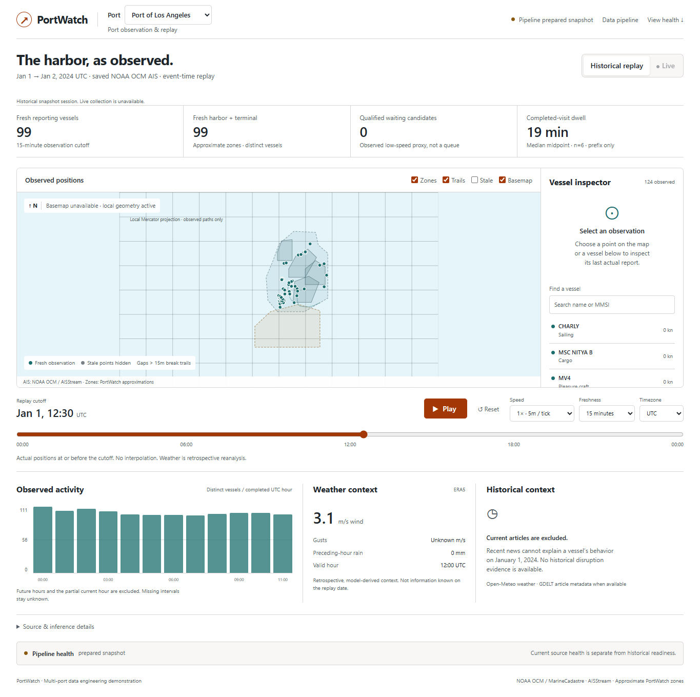
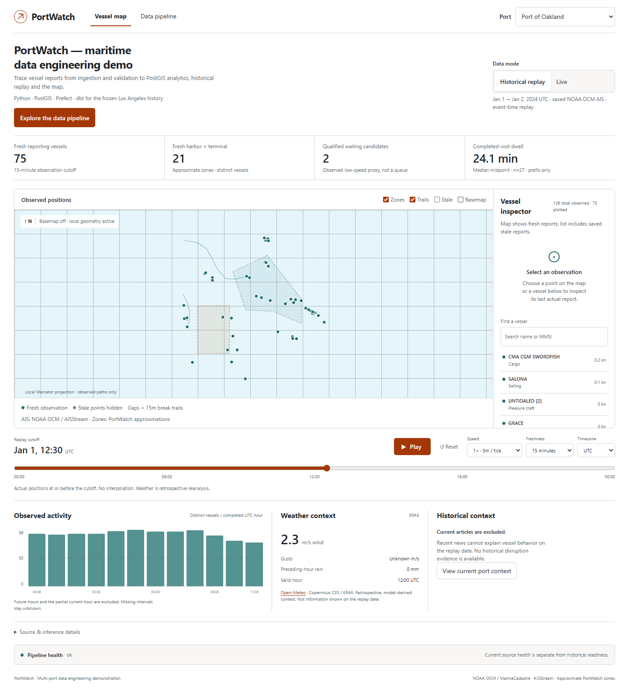
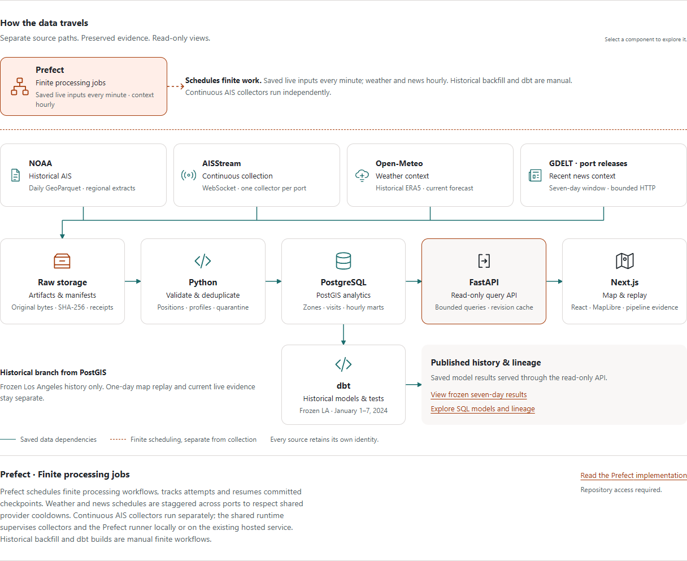
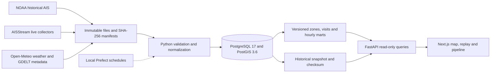

# PortWatch

[GitHub Actions: disabled by owner](https://github.com/SamABZD/portwatch/actions/workflows/ci.yml)

Vessel reports arrive with duplicates, gaps and incomplete context. PortWatch turns them into traceable observations, experimental port visits and hourly analytics for **Los Angeles and Oakland**. It preserves original inputs, makes transformations replayable, and shows what the evidence supports on a live map and historical replay.

**Works locally at $0:** Python/PostGIS processing, Prefect schedules, a read-only FastAPI service and a Next.js website. Historical replay needs no live API key; exported snapshots also work without a database. The owner disabled GitHub Actions; release validation runs locally. The repository remains private. Cloud deployment uses Vercel for the frontend and the owner's paid Railway Hobby workspace for the backend and database; see the [deployment record](deploy/README.md) for verified status and operating requirements.

## Product tour



This genuine NOAA snapshot at **2024-01-01 12:30 UTC** includes 99 fresh reporting vessels. It is a prepared historical session with live collection unavailable. Basemap requests were deliberately blocked during verification; local geometry remains usable.

1. Select **Historical replay**, choose a port and move the cutoff. Later observations, completed hours and visit confirmations stay outside earlier frames.
2. Select a vessel or search by name/MMSI. Inspect actual report time, available profile, approximate zone and incomplete visit evidence.
3. Compare reporting activity, completed-visit dwell samples and weather context. Unknown intervals remain unknown; low-speed candidates do not establish a cargo queue.
4. Open **Data pipeline** for the selectable architecture drawing, source states, actual counts and port-scoped workflow runs.
5. Enable **Live** after starting the separate runtime. Two collectors preserve received AIS reports; the website polls saved results every 30 seconds.

<details>
<summary>Oakland historical replay — 75 fresh reporting vessels at the recorded cutoff</summary>



</details>



[Screenshot provenance](docs/assets/README.md) · [Five-minute demonstration](docs/DEMO.md)

## Architecture



Historical and live datasets remain separate. Original records retain lineage even when observations deduplicate. Business rows publish transactionally before workflow checkpoints; failed publication preserves the previous analytical partition. Replay reconstructs evidence at its event-time cutoff. See [data contracts](docs/DATA_CONTRACTS.md), [orchestration](docs/ORCHESTRATION.md) and [metric definitions](docs/ANALYTICS.md).

| Layer | Technology |
| --- | --- |
| Ingestion and transformation | Python 3.11, PyArrow, bounded HTTP/WebSocket connectors |
| Spatial and analytical storage | PostgreSQL 17, PostGIS 3.6, eight SQL migrations |
| Orchestration | Prefect 3, resumable workflows, independent live collectors |
| Query service | FastAPI, Uvicorn, bounded read-only queries and revision-aware cache |
| Website | Next.js 16, React 19, TypeScript, MapLibre and local geometry fallback |
| Validation | uv lockfile, Ruff, pytest, PostgreSQL integration tests, Playwright |

## Run the historical demo

Requirements: Git, Python 3.11, [uv](https://docs.astral.sh/uv/getting-started/installation/), Node.js 20.9+ and PostgreSQL 17/PostGIS 3.6. Docker Compose is the portable database option; [existing native Windows cluster operation](docs/RUNBOOK.md#native-windows-database) is also documented. GitHub access is required while the repository is private.

From a new clone, using the default localhost configuration:

```sh
git clone https://github.com/SamABZD/portwatch.git
cd portwatch
uv sync --locked --extra dev
docker compose up -d --wait db
uv run --locked python -m portwatch db migrate
uv run --locked python -m portwatch doctor
uv run --locked python -m portwatch pipeline run --port los_angeles --demo --local
```

The first historical run downloads the genuine **227 MB NOAA file for January 1, 2024** and matching ERA5 weather; it needs internet and local disk space. Matching reruns verify and reuse saved artifacts. No AISStream key or running Prefect server is needed with `--local`. Add Oakland with the pipeline command using `--port oakland`. Optional overrides are in [.env.example](.env.example); copy it to an ignored `.env` only for local changes. Its password is a public localhost example. An existing `.env` must match the database you start.

Keep the API running in the project root:

```sh
uv run --locked python -m portwatch demo serve --listen-port 8000
```

In a second terminal, enter `web` inside the cloned `portwatch` directory:

```sh
cd web
npm ci
npm run build
npm run start
```

Open [localhost:3000](http://127.0.0.1:3000) and select **Historical replay**. The [pipeline page](http://127.0.0.1:3000/pipeline) explains the components. Stop API/frontend with Ctrl+C; `docker compose stop db` preserves its volume. Docker startup was unavailable on the audit machine: Step 13 exercised fresh native PostgreSQL/PostGIS reproduction from saved genuine inputs. It did not re-download upstream data or prove current provider availability.

For a database-free session, export after processing, stop the ordinary API, then serve the export:

```sh
uv run --locked python -m portwatch demo export --output data/demo/los-angeles.json
uv run --locked python -m portwatch demo serve --prepared data/demo/los-angeles.json
```

The snapshot/checksum stay ignored. Live collection and current health are unavailable in prepared mode. See [replay options](docs/REPLAY.md).

## Measured results

Frozen period: **2024-01-01 00:00 UTC to 2024-01-02 00:00 UTC**, exclusive end. These are regional observations, not complete port coverage.

| Measure | Los Angeles | Oakland |
| --- | ---: | ---: |
| Extracted reports | 62,159 | 52,785 |
| Canonical positions | 62,157 | 52,783 |
| Distinct observed vessels | 141 | 172 |
| Duplicates with preserved lineage | 2 | 2 |
| Historical quarantines | 0 | 0 |
| Fresh pipeline, saved local inputs | 65.45 s | 59.38 s |
| Forced repeat | 24.47 s | 25.01 s |

Both-port reruns reproduced identical business and metric digests. LA uncached/cached replay frame samples were 0.457/0.045 seconds. Complete fresh-database/API/export/recovery verification took 295.53 seconds on Windows/Python 3.11, eight logical CPUs and approximately 24 GiB RAM. These are local samples, not production guarantees.

The [audit](docs/RELEASE_CHECK.md), [results](docs/RESULTS.md) and [reviewed evidence](docs/evidence/README.md) distinguish genuine-data reproduction from synthetic failure drills.

## Verification and recovery

```sh
uv run --locked --extra dev python scripts/validate.py
cd web
npm run typecheck
npm run build
```

Step 13 passed **242 tests: 185 unit and 57 integration**. The health/deployment follow-up passed **258 tests: 194 unit and 64 integration**, lint/format, package/installed-wheel checks and eight fresh migrations with zero on repeat. The Next.js production build passed locally and on Vercel. Browser checks covered replay, both ports, prepared sessions, keyboard/mobile behavior and the drawing. Integration tests need PostgreSQL 17/PostGIS 3.6 and create owned temporary schemas. Deterministic tests reject provider connections.

The [Validate workflow](.github/workflows/ci.yml) runs shared Python `quality` and `integration` gates. Hosted jobs were blocked before execution by GitHub account billing; local passes do not establish a remote pass. Next.js/browser verification is local. [GitHub setup](docs/GITHUB_SETUP.md) records pending gates.

From the project root:

```sh
uv run --locked python -m portwatch health --port los_angeles
uv run --locked python -m portwatch db backup --output artifacts/manual-backup.dump
```

Backup verification restores into a new owned database and requires PostgreSQL client tools on PATH or the prepared native runtime. Failure drills demonstrated rollback, duplicate replay, quarantine, late-report replacement, corruption detection and reconnect gaps. [Recovery contracts](docs/HEALTH_RECOVERY.md) and the [runbook](docs/RUNBOOK.md) include diagnosis, restore and restart commands.

## Live operation and limitations

Set `PORTWATCH_AIS_API_KEY` privately in the ignored root `.env`, then run `uv run --locked python -m portwatch.runtime` from the project root. Stop with `uv run --locked python -m portwatch.runtime --stop`. See [multiport operation](docs/LIVE_MULTIPORT.md) for process ownership, gaps, cooldowns and storage growth.

- The computer must stay awake and connected. Public hosting, HTTPS, boot supervision and off-device backup remain pending.
- NOAA is provider-preprocessed; live coverage is incomplete. Live analysis uses receipt-time fallback with provider timestamp text preserved separately.
- Zones are approximate. Inferred visits, waiting and dwell are experimental, not official calls, confirmed queues or causality.
- Weather is coarse model context. GDELT returned HTTP 429 during the audit; successful real article coverage remains unverified. Recent news is excluded from replay.
- A repository alone does not run collectors, processing, the database or website. No paid hosting or account changes have been made.

## Sources and attribution

Historical AIS: **NOAA Office for Coastal Management / MarineCadastre.gov, 2024 AIS vessel traffic**, [CC0 data and suggested citation](https://github.com/ocm-marinecadastre/ais-vessel-traffic/blob/main/data/ais-broadcast-points-2024-readme.md). Weather: [Open-Meteo](https://open-meteo.com/) and [Copernicus Climate Change Service / ERA5](https://cds.climate.copernicus.eu/datasets/reanalysis-era5-single-levels?tab=overview), transformed UTC selections with [CC BY 4.0 attribution](https://open-meteo.com/en/licence) and applicable noncommercial API terms. Live: [AISStream](https://aisstream.io/). News metadata: [GDELT](https://www.gdeltproject.org/) and original publishers. Optional basemap: OpenStreetMap contributors.

Included artifacts are reviewed historical screenshots and aggregate reports. Raw files, live payloads, databases, snapshots and credentials stay excluded. The [source audit](docs/SOURCE_AUDIT.md) records redistribution and timestamp limits. PortWatch polygons are independently authored approximations; official port maps are contextual references.

[Release notes](docs/RELEASE_NOTES.md) · [Demo guide](docs/DEMO.md) · [Contributing](CONTRIBUTING.md) · [Handoff](docs/HANDOFF.md)
