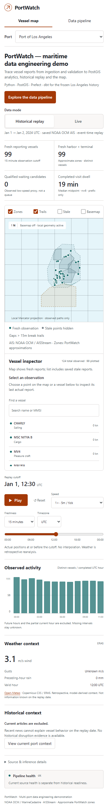
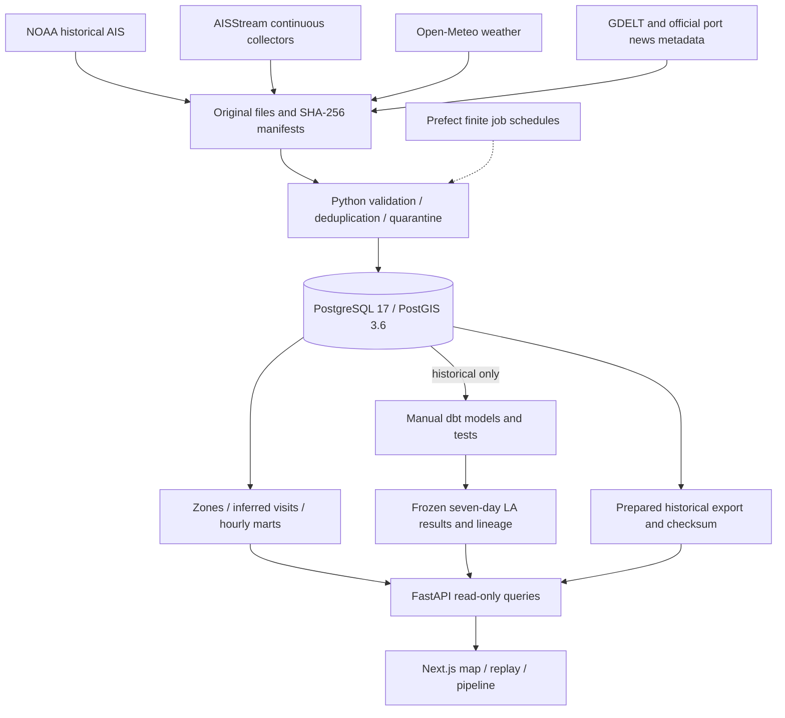

# PortWatch

**A maritime data engineering portfolio project for Los Angeles and Oakland.** Vessel reports arrive with duplicates, gaps and incomplete context. PortWatch preserves that evidence, turns it into traceable observations and experimental port analytics, and lets a reviewer inspect the pipeline or replay what was observable at a particular time.

**[Explore the demo](https://portwatch-iota.vercel.app/)** · **[Inspect the pipelines](https://portwatch-iota.vercel.app/pipeline)** · [SQL lineage](https://portwatch-iota.vercel.app/api/history-lineage?view=static) · [Documentation](docs/README.md)

The repository is public as observed on October 14, 2026. GitHub Actions remain disabled; verification below is local evidence, not hosted CI. Phases 4–5 are prepared on a feature branch for the Phase 6 release; production currently serves the previous release.

## What this demonstrates

- **Reproducible batch and live ingestion:** genuine NOAA historical AIS, separate continuous AISStream collectors, and independently fetched weather/news context.
- **Evidence and quality:** immutable original files, SHA-256 manifests, retained duplicate lineage, validation and quarantines before analytical publication.
- **Geospatial processing:** PostGIS zone assignments, experimental visit transitions and versioned hourly marts. Unknown coverage remains distinct from a valid zero.
- **Event-time replay:** a cutoff excludes later observations, completed hours and visit confirmations. No interpolated movement or invented port calls.
- **Recovery and orchestration:** resumable Prefect jobs, idempotent checkpoints, transactional analytical replacement, bounded retries and source cooldowns.
- **Inspectable SQL:** a separate dbt environment builds and tests historical PostgreSQL models; published lineage describes a frozen seven-day Los Angeles snapshot.

## A five-minute review


**Los Angeles · historical · January 1, 2024, 12:30 UTC.** Genuine NOAA evidence: 99 fresh reporting vessels at a 15-minute threshold. The saved list also includes stale observations. Basemap is off; PortWatch's local geometry remains usable. Weather is retrospective [Open-Meteo](https://open-meteo.com/) / Copernicus C3S ERA5 context, transformed into UTC selections under [CC BY 4.0](https://open-meteo.com/en/licence), not a forecast known on the replay date.

1. Choose **Historical replay**, select a port and move the cutoff. Compare fresh reporting vessels with all saved observations.
2. Search by vessel name or MMSI, then select a map point or list row. Inspect its actual report time and incomplete visit evidence.
3. Toggle zones, trails, stale reports and the basemap. Trails preserve recorded segment boundaries; source gaps remain gaps.
4. Open **Data pipeline** and select Python, PostGIS, dbt or Prefect. Follow original evidence through validation, publication and read-only queries.
5. Compare the one-day map replay with **Seven days of Los Angeles history** and open SQL lineage. Inspect the reproduction results below.

<details>
<summary>Oakland and mobile views</summary>


**Oakland · historical · the same UTC cutoff.** 75 fresh reporting vessels from its separate regional dataset. Weather attribution: [Open-Meteo](https://open-meteo.com/) / Copernicus C3S ERA5, transformed UTC selections, [CC BY 4.0](https://open-meteo.com/en/licence).



**Los Angeles · historical · 390-pixel viewport.** Map, inspector and context stack vertically. Weather attribution: [Open-Meteo](https://open-meteo.com/) / Copernicus C3S ERA5, transformed UTC selections, [CC BY 4.0](https://open-meteo.com/en/licence).

</details>


**Pipeline workspace.** Continuous collection, finite scheduled work and historical SQL modeling have distinct paths. The frozen dbt dataset is Los Angeles, January 1–7, 2024; it does not expand the one-day map replay or describe current live health.

[Screenshot provenance and checksums](docs/assets/README.md) · [Guided demonstration](docs/DEMO.md)

## Architecture



Historical/live identity stays separate throughout storage and queries. Weather enriches matching hours; recent news stays outside replay and does not multiply vessel metrics. Prefect schedules finite work; AISStream collectors run independently. dbt has no automatic schedule. Prepared exports provide historical replay without a database or current live health.

Implementation: [connectors](src/portwatch/context.py), [orchestration](src/portwatch/orchestration.py), [SQL migrations](src/portwatch/migrations), [dbt project](analytics), [read-only queries](src/portwatch/demo), [web components](web/src/components). Contracts: [data](docs/DATA_CONTRACTS.md), [analytics](docs/ANALYTICS.md), [replay](docs/REPLAY.md).

## Stack

Versions come from the manifests/lockfiles used for the October 14, 2026 reproduction.

| Layer | Runtime and dependencies |
| --- | --- |
| Processing | Python 3.11 tested; supported `>=3.11,<3.15`; PyArrow 26; root [uv lockfile](uv.lock) |
| Storage | PostgreSQL 17 / PostGIS 3.6; native reproduction on 17.11 / 3.6.2; eight migrations |
| Orchestration | Prefect **3.8.8**, finite resumable jobs and separate collectors |
| Query API | FastAPI **0.143.0**, Uvicorn **0.54.0**; bounded read-only queries |
| Historical SQL | Separate [analytics environment](analytics/pyproject.toml): dbt-core **1.12.5**, dbt-postgres **1.11.0**; PostgreSQL target |
| Website | Next.js **16.4.0**, React **19.3.0**, TypeScript **5.9.3**, MapLibre **6.14.0** |
| Frontend runtime | Node.js `>=20.9`; reproduction on **24.15.0**; [npm lockfile](web/package-lock.json) |
| Verification | Ruff, pytest with PostgreSQL integration tests, Node tests and Playwright |

## Run the historical demo

Requirements: Git, Python 3.11, [uv](https://docs.astral.sh/uv/getting-started/installation/), Node.js 20.9+ and PostgreSQL 17/PostGIS 3.6. Docker Compose is the portable database option; [native Windows operation](docs/RUNBOOK.md#native-windows-database) is documented separately. The public repository can be cloned without GitHub credentials.

From a new clone, using the default localhost database configuration:

```sh
git clone https://github.com/SamABZD/portwatch.git
cd portwatch
uv sync --locked --extra dev
docker compose up -d --wait db
uv run --locked python -m portwatch db migrate
uv run --locked python -m portwatch doctor
uv run --locked python -m portwatch pipeline run --port los_angeles --demo --local
uv run --locked python -m portwatch pipeline run --port oakland --demo --local
```

Each port's first historical run needs the genuine **227,181,435-byte NOAA January 1, 2024 national file** and matching ERA5 weather. Allow internet access, database capacity and disk space; per-port receipts may retain separate raw copies. Matching reruns verify and reuse saved inputs. Historical replay needs no AISStream key and `--local` needs no Prefect server. Optional overrides belong in an ignored `.env`; [.env.example](.env.example) contains a public localhost password example. Existing settings must match the database you start.

Keep the API running in the project root:

```sh
uv run --locked python -m portwatch demo serve --listen-port 8000
```

In a second terminal, enter `web` inside the cloned project:

```sh
cd web
npm ci
npm run build
npm run start
```

Open [localhost:3000](http://127.0.0.1:3000/) and choose **Historical replay**. API port is **8000**, frontend port is **3000**. Stop both processes with Ctrl+C; run `docker compose stop db` from the project root to preserve its volume. Repeat the same pipeline commands to resume; `--rebuild` explicitly recomputes analytics from verified saved inputs.

The October 14 clean-clone audit exercised locked installs, migrations and both pipelines against a fresh owned database on an already-running native PostgreSQL/PostGIS server, reusing genuine saved inputs. Docker startup, socket-server startup and fresh upstream downloads were **not exercised**; in-process API checks verified the query contract. [Exact scope and results](docs/evidence/phase5-public-readiness.json).

For a database-free Los Angeles session, export after processing, stop the ordinary API and serve the snapshot:

```sh
uv run --locked python -m portwatch demo export --output data/demo/los-angeles.json
uv run --locked python -m portwatch demo serve --listen-port 8000 --prepared data/demo/los-angeles.json
```

Exports/checksums stay ignored. Prepared sessions expose only their saved port, select historical mode and disable live/current health. [Replay guide](docs/REPLAY.md).

The separate dbt environment is optional for the one-day demo:

```sh
uv sync --project analytics --locked
```

Follow [historical/dbt operations](docs/HISTORY_DBT.md) for the bounded seven-day backfill and `pipeline models` command. That downloads substantially more data; it is not part of page navigation or demo startup.

## Pipeline guide

| Boundary | Evidence and inspection |
| --- | --- |
| Original | `data/raw` plus immutable manifests; source identity, checksum and receipt time survive transformation. [Source audit](docs/SOURCE_AUDIT.md) |
| Normalized | `ais_positions`, source ledgers and quarantines; duplicates retain lineage. [Data contracts](docs/DATA_CONTRACTS.md) |
| Spatial and marts | Versioned zones, visit projections and hourly outputs; publication replaces an owned partition transactionally. [Metric definitions](docs/ANALYTICS.md) |
| Workflow | `pipeline_runs`, `pipeline_steps`, `pipeline_checkpoints`, `pipeline_source_gaps`; failed/missing inputs stay auditable. [Orchestration](docs/ORCHESTRATION.md) |
| Historical SQL | `pipeline_models` audit, 11 dbt models, typed hourly results and standalone lineage. [History/dbt](docs/HISTORY_DBT.md) |
| Query/export | Read-only API, bounded event-time frames and checksum-protected prepared snapshots. [Replay](docs/REPLAY.md) |

Input fingerprints and rule versions determine checkpoint reuse. Business rows commit before workflow checkpoints; interruption between those commits resumes idempotently. Late reports or changed quality/context invalidate publication. Prefect retries transient failures twice; connectors use bounded retries, preserve rate-limit cooldowns and distinguish failure from a verified empty result. Page refreshes never start ingestion.

The source defaults register minute live-processing and hourly weather/news jobs, staggered across ports. Existing deployments can use audited, reduced schedules; [runtime ownership and current operations](docs/LIVE_MULTIPORT.md) and [cost-control evidence](docs/evidence/phase1-cost-controls.json) record those settings. Continuous collectors preserve incoming evidence separately. [Health and recovery](docs/HEALTH_RECOVERY.md) explains backlog, stale sources and failed runs.

## Measured evidence

**Clean-clone reproduction: October 14, 2026, Windows / Python 3.11.9 / PostgreSQL 17.11 / PostGIS 3.6.2.** Saved genuine input; no provider requests. Historical interval: **January 1, 2024 UTC**, exclusive January 2 end. Regional observations do not establish complete port coverage.

| Measure | Los Angeles | Oakland |
| --- | ---: | ---: |
| Extracted reports | 62,159 | 52,785 |
| Canonical positions | 62,157 | 52,783 |
| Distinct observed vessels | 141 | 172 |
| Duplicates with retained lineage | 2 | 2 |
| Historical quarantines | 0 | 0 |
| Fresh pipeline using saved inputs | 73.052 s | 55.277 s |
| Forced analytical repeat | 17.826 s | 14.911 s |

Both runs preserved identical business, profile and per-port mart digests. Twenty recorded commands passed, including migrations (**8 applied / 0 on repeat**), locked installs, frontend build, both exports and in-process database/prepared API parity at **12:30 UTC** (**99 / 75 fresh vessels**). Original source checksums stayed unchanged; the owned test database was removed. Temporary-clone cleanup was rejected by automatic approval review, so scratch cleanup remains incomplete. [Reproduction and exposure record](docs/evidence/phase5-public-readiness.json).

The separately frozen **seven-day Los Angeles** result contains **443,296 positions, 168 hours, 11 SQL models and 36 dbt tests** for January 1–7, 2024. Its [historical evidence](docs/evidence/history-dbt.json) and [cloud parity/restore evidence](docs/evidence/cloud-history-operations.json) predate this frontend refinement. The map keeps bounded one-day history. Preliminary anomaly labels require more preceding history than this snapshot provides.

Current frontend validation passes `npm run typecheck`, `npm run build`, and **14 Node tests** for URL state and visible polling. [Phase 4 workspace evidence](docs/evidence/phase4-workspace.json) records current browser checks and limits; [Phase 5 readiness](docs/evidence/phase5-public-readiness.json) records reproduction and exposure review. The earlier full Python validator passed **329 tests** in Phase 3; backend code is unchanged in phases 4–5. [Dated evidence archive](docs/evidence/README.md) keeps previous counts separate.

The full release validator belongs to Phase 6:

```sh
uv run --locked --extra dev python scripts/validate.py
cd web
npm run typecheck
npm run build
node --test scripts/view-state.test.mjs scripts/visible-polling.test.mjs
```

Integration tests need PostgreSQL/PostGIS and owned temporary schemas. Deterministic tests reject provider connections. The [workflow source](.github/workflows/ci.yml) defines Python quality/integration gates, but Actions are disabled; local passes do not establish a GitHub-hosted pass.

## Demo costs and operation

Historical replay uses **$0 local services**; it still needs your computer, storage and internet. Hosted operation uses the existing Vercel frontend and Railway backend/database. Railway is paid usage; no permanently free 24/7 hosting or verified zero cloud cost is claimed. Phases 4–5 added no paid service, replica, volume or collector schedule. Preview verification used the existing Vercel Hobby project. Measured incremental cloud cost remains a Phase 6 check.

The deployed runtime owns both live subscriptions. Keep local live collectors stopped while it runs. For an independent local setup, configure `PORTWATCH_AIS_API_KEY` privately and follow [LIVE_MULTIPORT.md](docs/LIVE_MULTIPORT.md). A sleeping local computer cannot collect missed evidence.

Backups are operator work. From the project root:

```sh
uv run --locked python -m portwatch health --port los_angeles
uv run --locked python -m portwatch db backup --output artifacts/manual-backup.dump
```

[Runbook](docs/RUNBOOK.md) and [recovery contracts](docs/HEALTH_RECOVERY.md) cover restore into a new owned database, checksums, restart and diagnosis. Full live history grows; off-device backup and storage management remain requirements. [Deployment operations](deploy/README.md) preserves detailed rollout history.

## Sources, limitations and reuse

- **Historical AIS:** NOAA OCM / MarineCadastre.gov 2024 AIS vessel traffic, [CC0 dataset and suggested citation](https://github.com/ocm-marinecadastre/ais-vessel-traffic/blob/main/data/ais-broadcast-points-2024-readme.md). Provider preprocessing and incomplete regional observations limit coverage claims.
- **Weather:** [Open-Meteo](https://open-meteo.com/) and [Copernicus C3S / ERA5](https://cds.climate.copernicus.eu/datasets/reanalysis-era5-single-levels?tab=overview), transformed UTC selections under [CC BY 4.0 and applicable API terms](https://open-meteo.com/en/licence). Coarse model context does not establish vessel delay causes.
- **Live AIS:** [AISStream](https://aisstream.io/). Receipt-time fallback preserves provider timestamp text separately. Redistribution terms remain unverified; no raw/live payload or live vessel screenshot is packaged here.
- **News metadata:** [GDELT](https://www.gdeltproject.org/), [Port of Los Angeles official release archive](https://portoflosangeles.org/news/news-release-archive), [Port of Oakland official RSS](https://www.portofoakland.com/feed/) and original publisher links. Only title/link/date metadata is retained. Official fallbacks cover releases, not all disruption news. Rate limits, source errors and a verified empty result stay distinct; news stays outside replay.
- **Maps and inference:** optional tiles credit [OpenStreetMap contributors](https://www.openstreetmap.org/copyright). Packaged screenshots have basemap off. PortWatch polygons are independently authored approximations; inferred visits, waiting and dwell are experimental, not official calls or confirmed queues.

Only reviewed historical screenshots and small aggregate evidence are packaged. Raw files, live payloads, snapshots, environments, dumps and credentials stay excluded. The [readiness record](docs/evidence/phase5-public-readiness.json) includes a reachable-history audit: no credential was detected, while older public commits retain non-secret workstation/service context. Current document cleanup preserves that history; the owner can review whether to accept it or authorize remediation. A scanner cannot prove complete absence of secrets.

**Code license: none selected.** No root `LICENSE` grants permission to reuse the code; public visibility alone would not grant that permission. Third-party data has its own terms. [Source audit](docs/SOURCE_AUDIT.md) · [Contributing](CONTRIBUTING.md) · [Release notes](docs/RELEASE_NOTES.md)
