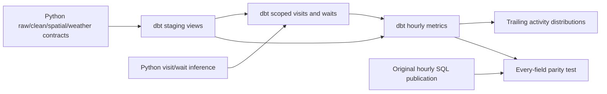

# Historical expansion and dbt

Step16 adds a bounded Los Angeles history run for **January1–7,2024 UTC** and an opt-in dbt
SQL project. The original one-day configuration, Python ingestion/visit inference, Prefect,
public reference tables and hosted live application retain their contracts. This stage uses
local resources and added no cloud deployment, storage service or paid subscription.
The owner later authorized a budgeted Railway rollout of this exact seven-day snapshot;
see [deployment operations](../deploy/README.md) and
[cloud verification](evidence/cloud-history-operations.json). Original source files remain
local, while the separate cloud analytical database and dbt outputs preserve the same hash.

## Capacity and source selection

All seven exact daily NOAA GeoParquet URLs returned HTTP200 to HEAD on2026-10-13. Their
combined size is1,589,333,765 bytes (1.48GiB); Jan1 was already cached, leaving1,362,152,330
bytes to download. Each source is below the existing512MiB per-file limit. Original bytes,
checksums and receipts are preserved in `data/raw`; regional extractions remain in `data/derived`.
There is no ZIP expansion: extraction streams at most65,536 national rows per Arrow batch and
produces a regional Parquet file. Temporary capacity reserves one maximum daily download plus
one regional output; publication renames the finished temporary file rather than copying it.

A fresh owned PostgreSQL17/PostGIS3.6 database reproduced Jan1 in88.68s with cached raw/extract
and weather evidence. Its growth was256,106,496 bytes (244.24MiB), including indexes.
Application table heap/index sizes were135,274,496/121,012,224 bytes. The regional extract is
4,089,031 bytes for62,159 source rows, yielding62,157 canonical observations. The cached
extraction verification took0.73s; new daily extractions are timed separately in the run audit.

Linear seven-day database growth projects1.67GiB. Planning reserves twice this growth, twice
the regional extract size, the remaining downloads, one maximum daily temporary source and
1GiB for WAL/maintenance: an initial5.88GiB of additional disk, against34.84GiB initially free.
One-day activity-state rows/indexes measured34,807,808 bytes. Each of seven target-day
projections can retain seven days of states: allow another42 one-day state copies beyond
the linear estimate (1.36GiB), raising planned additional disk to about7.24GiB.
The1GiB WAL allowance is an estimate, not a measured peak. The cached linear pipeline time
is10.35min; it excludes network transfers and understates repeated full-context visit inference.
Actual download throughput and seven-day context cost determine elapsed time. Thirty days
are deliberately outside this initial bounded run; availability/capacity and elapsed time must
be remeasured before increasing the existing seven-day request limit.

## Reproduce without disturbing live collection

Use a separate local PostgreSQL database and set the existing `PORTWATCH_DB_*` environment
variables to it. Never start local collectors while the Railway runtime owns the two live
subscriptions. All commands below operate on the configured database; verify its identity first.
The stage evidence database has an owned `pw_step16_` name; local connection settings remain
private. Raw files are reusable across databases and ports with separate immutable receipts.

```powershell
uv run --locked python -m portwatch db migrate
uv run --locked python -m portwatch pipeline backfill --port los_angeles --start 2024-01-01 --end 2024-01-08 --local
```

Preparation processes one UTC day at a time, then publishes with at most seven contiguous
processed neighboring days. Successful clean/publication checkpoints are reusable. A missing
NOAA source retains its unresolved source-gap record and cannot become an empty successful day.
Use the same command to resume an interrupted run; do not delete ledgers/raw files.
Raw acquisition, extraction and cleaning retain their byte/lineage verification. Weather,
publication and validation no longer perform a redundant national-file scan before their
own work; those steps consume context/database contracts. This avoids repeatedly hashing
the entire1.48GiB archive in stages that do not read AIS files.

Historical weather is independently audited. On this run Open-Meteo produced actual HTTP502
and timeout failures. Strict mode still stops the affected day's publication. An explicit
`--allow-missing-weather` allows the AIS partition to finish after only a recognized provider
failure or cooldown. The step report says `unavailable`, with zero new weather rows; failed
attempts/checkpoints are preserved. A matching saved revision is reused if one actually exists;
otherwise marts have null weather and `weather_unavailable`. Programming/configuration errors
and AIS failures still stop the affected partition. Later successful weather changes the
analytical version and recomputes the affected output.

```powershell
uv run --locked python -m portwatch pipeline backfill --port los_angeles --start 2024-01-01 --end 2024-01-08 --allow-missing-weather --local
uv sync --project analytics --locked
$modelRun = uv run --locked python -m portwatch pipeline models --port los_angeles --start 2024-01-01 --end 2024-01-08 --local | ConvertFrom-Json
```

Omit `--local` to use the existing Prefect server. `portwatch-models` calls one finite
`dbt-build-and-test` task and records a `pipeline_models` SQL audit with node/test outcomes,
duration, public scope and artifact location. No second orchestrator or automatic dbt schedule
is added. `PORTWATCH_DBT_PYTHON` can select an absolute Python interpreter in another prepared
dbt environment. Invoking its CLI entry point directly lets the timeout stop the owned Python
process on Windows, without leaving a console-launcher child behind. A repository checkout
is required for the SQL project; the Python wheel alone
does not include it. Database credentials pass only through the process environment, using
dbt's redacted `DBT_ENV_SECRET_` password variable; AIS keys are removed from the child environment.

## SQL migration, lineage and test gates

The isolated `analytics/uv.lock` pins dbt Core1.12.5 and dbt-postgres1.11.0 plus transitive
dependencies. The adapter declares Core>=1.8,<2 and Python>=3.10; the selected Core also supports
Python3.11. The actual pair was installed and exercised on PostgreSQL17.11/PostGIS3.6.2.
Separate environments retain the existing working Prefect/runtime dependency lock.
References: [adapter setup](https://docs.getdbt.com/docs/local/connect-data-platform/postgres-setup),
[Core package metadata](https://pypi.org/project/dbt-core/1.12.5/),
[adapter package metadata](https://pypi.org/project/dbt-postgres/1.11.0/).



`stg_partitions` selects the latest publication within each daily source/clean/geofence/rule
series, retaining earlier versions in public. Context dataset identities and pinned weather
remain attached. The hourly macro deliberately carries the original `queries/hourly.sql`
definitions: hour-start snapshots, confirmation-hour transitions, qualified waiting proxies,
completed dwell samples, null/zero semantics and provider separation. Only SQL dependencies
and parameter bindings move; Python episode inference is unchanged. Its reference SQL hash
is recorded in the macro. Explicit bigint/double-precision casts preserve the reference output
types for reject counts and observation age; no metric values change. The hourly model enforces
its complete typed column contract. It does not select reference hourly values as its input.

Every invocation owns a new `pw_dbt_<uuid>` schema and ignored `artifacts/models/<uuid>` folder.
Existing business tables and earlier dbt outputs are preserved. Session advisory locks coordinate
with the existing port mutation lock and serialize model builds; no SQL transaction is held
open across the subprocess. One dbt thread, five-minute statement/5s lock limits and bounded
command time keep work finite. Small models recompute fully: no incremental late-arrival or
replacement policy is implied. Failed builds remain inspectable and are never adopted by the
hosted read API. Retained output schemas/artifacts need explicit operator retention management.

Data tests cover unique/not-null grains, partition/episode relationships, accepted statuses,
assignment completeness, hourly reconciliation, complete requested days, original-output
equivalence in both directions and baseline gating. Optional AIS metadata is not required.
Archive readiness checks requested intervals and processed historical inputs; it does not
compare a2024 archive timestamp with today's clock. Opt-in `--check-live` separately measures
AISStream **receipt** freshness for the exact selected-port dataset (warn5min/error15min).
Default local runs do not claim live freshness while local collectors are stopped. See the
[dbt freshness contract](https://docs.getdbt.com/reference/resource-configs/freshness).

Each successful run saves `summary.json`, `target/manifest.json`, `catalog.json`, build/test
results and standalone `static_index.html`. Inspect the manifest DAG or open the static docs
for model SQL, columns and tests. These generated artifacts remain ignored because they contain
local database/schema metadata. The sanitized stage evidence links the actual observed results.

## Preliminary baselines

For each hour, `activity_baselines` computes the count and UTC dates of available historical
hours, sample bounds/dataset identities and observation-count p05/p50/p95 over the preceding
30 days. It excludes the current interval, future hours, incomplete source intervals and
pending/failed cleaning. Different ports/providers/cleaning/geofences/rules/metric configurations
never share samples; daily pinned weather/context identities do not split otherwise comparable
observed-activity definitions. Source availability and row quality flags stay visible.

Anomaly labels require at least168 **prior** hours across seven UTC dates and an available
current source interval. A dataset containing exactly seven days has at most167 prior hours,
so all anomaly labels remain null. Distributions are descriptive of this small observed sample;
seven days cannot establish seasonal expectations, total AIS coverage, operational congestion
or a cause. Source changes or reporting coverage shifts can resemble activity changes even
when definitions match. Do not sum daily contextual episode projections as independent visits.

The original one-day demo continues to use `configs/demo.yaml` and its original transform.
Step16 stops at local history and model validation; Step17 remains skipped by the owner.

For read-only reconciliation after a successful model run, use the returned schema:

```powershell
uv run --locked python scripts/verify_history.py --schema $modelRun.schema --output artifacts/step16/history-verification.json
```

The command requires a local database and an actual32-hex owned schema name. It verifies
168 unique complete hours, position reconciliation, every-field parity, suppressed small-sample
labels, cross-day episodes and null completed-duration bounds for partial episodes. It reports
both per-vessel slice edges and partial episodes within15min of the global interval edges;
a vessel's first/last report can occur inside the week. Reports do not establish ground truth
arrival/departure times or official port calls.

## Observed completion

[The measured report](evidence/history-dbt.json) verifies443,296 canonical observations,
168 unique complete hours, all168 matching weather hours and zero reference differences.
Two dbt builds produce identical business rows; resumption preserves the original canonical
business hash and reuses all seven clean checkpoints. Eleven models/36 data tests and the
45-column hourly type contract pass; full Python validation passes208 unit +68 integration.
The initial strict run took2,322.96s. The resumed run includes an interrupted gap, so its wall
time is not a compute benchmark. Source failures remain audited after successful recovery.
Standalone docs/lineage rendered in Chrome. See [handoff](HANDOFF.md) for local state/evidence.
